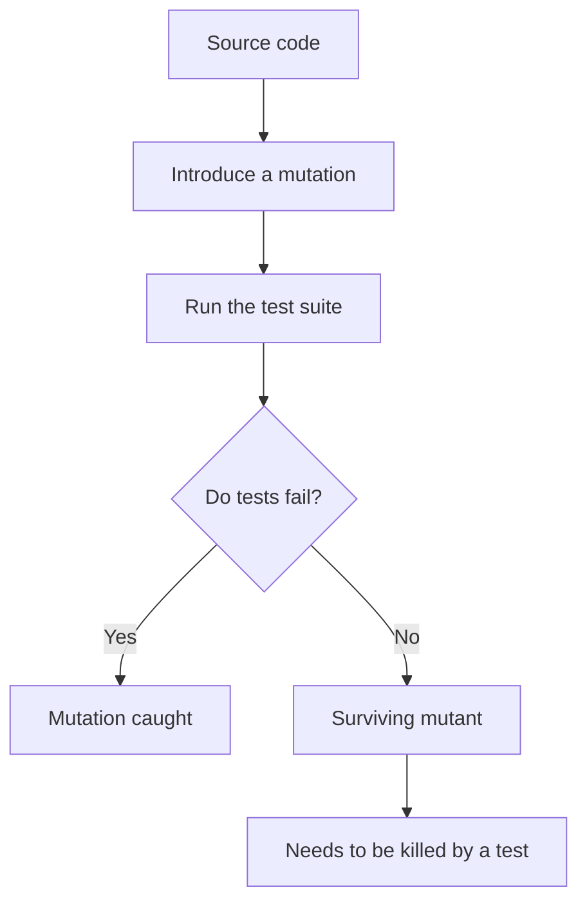
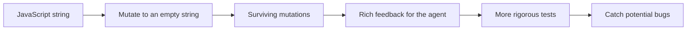

Mutation testing checks whether tests detect deliberate source-code changes.

The string-mutation example supplies feedback for strengthening agent-written tests.

## Transcript

[00:00.000–00:04.900] Having a high quality test suite is essential for agents, but how do you know that your test

[00:04.900–00:09.920] suite is as good as it could be? Well, one way to improve your test suite is to do mutation

[00:09.920–00:15.240] testing on it. What mutation testing does is it will look at your source code and it will make

[00:15.240–00:19.840] mutations to it. So in here it's modify this JavaScript string to just be an empty string.

[00:19.980–00:25.200] Then it will rerun your tests and see if your tests fail. And every one of these mutations

[00:25.200–00:30.960] that survive your tests, that is a surviving mutant. And it's a mutant that needs to be killed.

[00:31.180–00:36.960] This gives your agent really rich feedback about how good its tests are. And you'll find that it

[00:36.960–00:42.100] produced much more rigorous tests after this. And you know that every one of those tests is actually

[00:42.100–00:46.320] catching a potential bug in your system. So I freaking love mutation testing and I recommend

[00:46.320–00:50.940] it to anyone who is a little bit scared about the quality of the test their agent is writing.

[00:50.940–00:55.800] In this example, I use Stryker.js for TypeScript, but there are plenty of options out there

[00:55.800–00:57.500] depending on what language you're working in.

