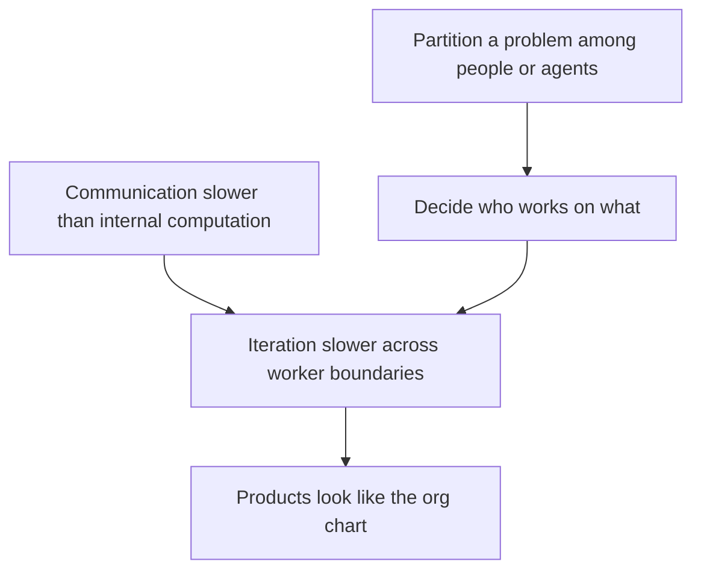
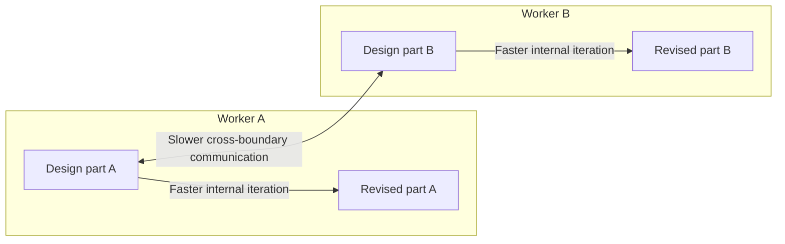

Partitioning work constrains design iteration; resemblance to the org chart is a downstream consequence.

Iteration within either part is faster than iteration across the communication boundary.

## Transcript

[00:00.000–00:03.400] What is the only unbreakable law in software engineering?

[00:03.660–00:08.180] The only thing I've seen that feels like a real law to me is the thing I cover in this lecture,

[00:08.300–00:18.180] which is Conway's law. And it is that if you would like to organize a series, like a set of

[00:18.180–00:23.920] people to work on something, or in the modern parlance, let's say agents, if you need to

[00:23.920–00:32.000] partition a problem into a set of workers in this way where the communication between those workers

[00:32.000–00:38.420] is slower than their own internal computation ability. When you start to tackle a problem

[00:39.160–00:43.760] in order to get the benefits of that parallelization, you will have to make

[00:43.760–00:50.020] decisions about who is working on what. Once you've made that decision, you have now locked in

[00:50.020–01:00.900] the fact that the iteration on the design will be slower across that boundary than it is interior

[01:00.900–01:05.660] to either of the two parts. One way the rule is pithily stated is products look like the org chart,

[01:06.280–01:11.540] right? But that's not exactly what it says, but that's a downstream consequence.

[01:12.320–01:15.560] And boy, do you ever see it in the real world.

